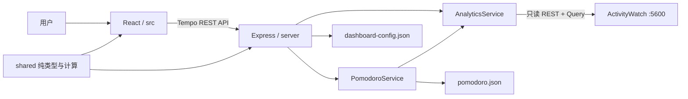
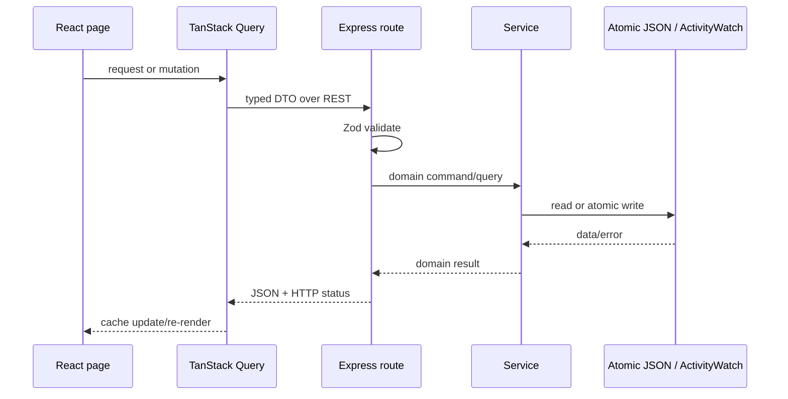
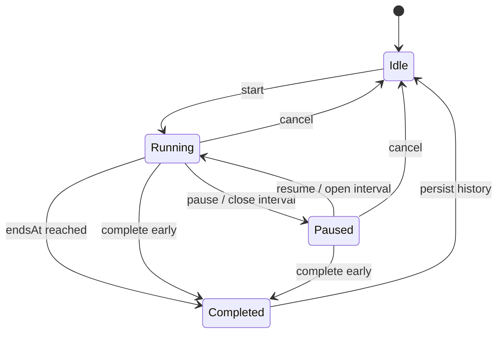
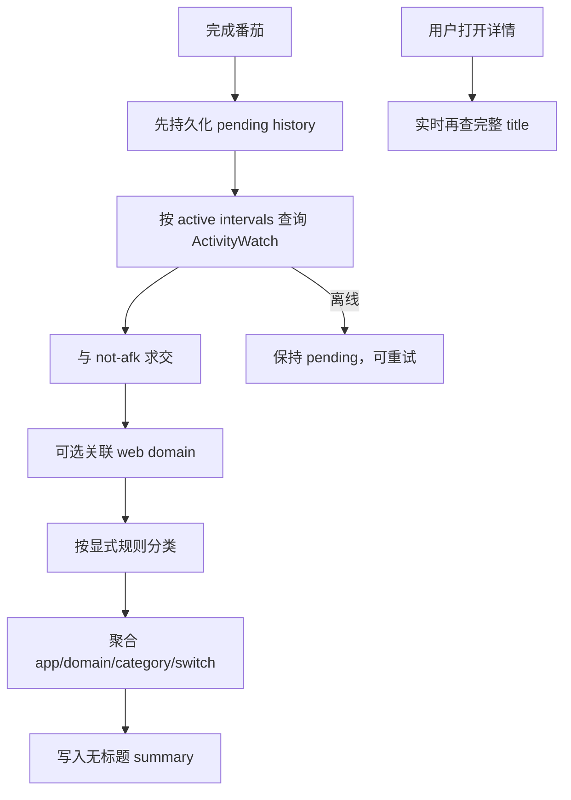
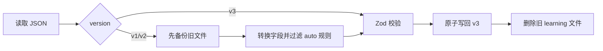

# 架构说明

本文不只回答“文件在哪”，还回答“为什么需要这一层”。Tempo 是一个**模块化单体（modular monolith）**：浏览器前端与一个 Express 进程共同交付，但代码按职责划分模块。个人本地应用不需要微服务的网络治理和独立部署成本，却仍需要清晰边界来防止所有逻辑挤进 React 页面。

## 1. 总体边界

问题：前端、计时、分析和文件写盘都可能改变。约束：单用户、本机、隐私优先、ActivityWatch 不可被修改。当前方案让依赖方向从页面指向 API，从业务 Service 指向存储/ActivityWatch，而不是反过来。

- `src/` 负责交互和展示，不决定状态转换是否合法。
- `server/app.ts` 是 HTTP adapter：验证输入、调用服务、把错误映射成状态码。
- `PomodoroService` 持有领域状态机；“running 能否 resume”是业务规则。
- `PomodoroStore` 与 `AtomicJsonFile` 负责持久化机制，不理解番茄含义。
- `AnalyticsService` 隔离 ActivityWatch 的 bucket、Query 和 AFK 细节。
- `shared/` 只放两端都需要且尽量无 I/O 的类型与纯函数。

如果删掉 Express 层，把计时只放 React：关闭标签页后计时状态没有可靠所有者，多标签页也会竞争。如果项目只是一个不保存状态的静态图表，确实不需要 Express。

## 2. 请求流

这里的“模块”不是文件夹的好听叫法，而是拥有明确输入、输出和责任的边界。“单一职责”也不等于每个文件只能做一行事，而是它只有一个主要的变化原因：ActivityWatch API 变化应主要影响 `AnalyticsService`，文件替换策略变化应主要影响 `AtomicJsonFile`。

## 3. 番茄状态流

`ActivePomodoro.intervals` 记录真正运行的区间；暂停就是关闭当前区间，继续就是新开一个区间。因此分析天然排除暂停，不需要事后猜测。`endsAt` 使用墙上时间而非“已经 tick 了多少次”：电脑休眠一小时后，时间仍然过去一小时。服务每秒只检查是否到期，不每秒写盘。

浏览器每三秒向服务校准领域状态，但每秒变化的显示数字由计时器组件局部推导。这样页面仍以服务端为事实源，同时不会让全局 Context 的高频更新迫使 Overview 图表反复渲染。ECharts 实例也只在组件挂载时创建，数据变化时更新 option，而不是销毁重建。

非法转换返回 409，因为请求语法正确，但与当前资源状态冲突。用 400 会把“客户端字段格式错误”和“已经暂停却再次暂停”混在一起。

## 4. 完成与活动分析

关键顺序是“先保存完成，再尝试分析”。否则 ActivityWatch 离线会让用户连计时成果也丢掉。完整标题和 URL 只出现在按需 API 响应中；磁盘摘要只有应用、域名、分类、时长和切换次数。

## 5. 配置迁移

迁移属于输入边界：业务代码只接触 v3，不需要到处写 `if (config.version === 2)`。如果删掉迁移层，旧用户升级后只能丢配置或让每个消费者理解所有历史版本。一次性实验项目可以直接清空旧数据；已经有用户数据的应用不应这么做。

## 6. 术语落到本项目

- **领域状态（domain state）**：`running / paused` 以及合法转换，代表业务事实。
- **基础设施（infrastructure）**：文件系统、HTTP、ActivityWatch 客户端，是业务依赖的外部机制。
- **依赖方向（dependency direction）**：高层业务调用低层机制；文件系统不能反过来 import React 页面。
- **所有权（ownership）**：番茄状态只有 Express 服务可以修改；浏览器只是观察者和命令发送者。

## 7. 技术债

- `server/app.ts` 仍是一个集中路由文件；端点继续增长时可按 config/categories/pomodoro 拆 router。
- 进程内 reconciler 在进程完全停止时不会运行；重启后的首次读取会补记，但无法在停机期间主动弹通知。
- JSON 写入适合单进程；两个 Tempo 进程共享数据目录时没有跨进程锁。
- 日期指标目前依赖配置中的日界线。若 ActivityWatch 日界线运行时改变，应把解析后的边界作为显式服务依赖。

这些限制是已知权衡，不等于 bug；触发升级条件见 `INDUSTRY-ALTERNATIVES.md`。
